# Pedro: features, workflows and how it works

**For:** the team, and anyone checking how these features work before the demo.
**Date:** 15 Nov 2026. **Rule we followed:** if we can't explain exactly how a feature works and cite why it matters, it's out. Section 10 lists what we cut. Section 6 has the workflows and section 7 the NASA studies.

---

## 1. What's new

| Feature | Who uses it | One-line job |
|---|---|---|
| **Wearable vitals** | Astronaut (Home), Ground | Five overnight readings, each against the person's own normal |
| **3D body map** | Astronaut (check-in) | Mark where it hurts, how bad, what it is and when it happens |
| **Ground dashboard** | Flight surgeon | Whole crew on one screen: vitals, escalations, team status, team log |
| **Escalations page** | Flight surgeon | What's open now, and a 14-sol log of how it got there |
| **Pedro reports** | Flight surgeon | Each astronaut's check-in submission per sol, with Pedro's summary and the body map |
| **Crew status (modal)** | Flight surgeon | One person in depth, comparison with Earth ranges, **Download PDF** |
| **Brain update** | Pedro | 7 new knowledge files so Pedro can explain vitals, the body map and what reaches Earth |

All crew data is **simulated** and labelled "Simulated data" on every screen.

### Who each feature helps, and why it matters

NASA expects crews far from Earth to "solve problems and identify solutions as a team without help from NASA's mission control" ([NASA](https://www.nasa.gov/humans-in-space/the-human-body-in-space/)). So every feature has two jobs: help the astronaut act on board **now**, and give Earth a clear picture **later**.

| Feature | How it helps the astronaut | How it helps the Earth crew (flight surgeon) | Why it matters |
|---|---|---|---|
| **Daily check-in** (2 min) | Catches slow drift in sleep, mood, workload and teamwork that people don't notice in themselves | Per-person submissions in Pedro reports, by sol | NASA: "Sleep loss, circadian desynchronization, and work overload compound" the isolation hazard ([NASA](https://www.nasa.gov/hrp/hazard-isolation-and-confinement/)) |
| **Own-normal statuses** | Compared only with themselves, so one person's normal isn't another's alarm. One bad night never flags | Watch and Act mean the same thing for every person, so a list of names can be read quickly | Under-reporting is a known astronaut behaviour (*Safe Passage*, ch. 8). Measuring beats asking |
| **Wearable vitals** | Five overnight readings with a plain status, nothing to type | Every crew card shows all five. Urgent vitals reach Escalations by name | NASA: "Weightlessness alters blood circulation and how the heart and blood vessels function" ([NASA](https://www.nasa.gov/hrp/risks/)). An early infection pattern matters in a closed hab |
| **3D body map** | Shows exactly where it hurts, how bad and when, by tap or voice. Repeats are visible and can be followed up | Sees the exact spot, rating and note, not "some pain" | NASA: weightlessness "can lead to dizziness, bone and muscle loss" ([NASA](https://www.nasa.gov/hrp/hazard-gravity-fields/)). Exercise to counter it can strain muscles |
| **Pedro (offline AI)** | Answers "what does this mean, what can I do" with sources, even with no link to Earth | Fewer routine questions sent to Earth. Companion counts show how it is used | NASA: "a communication delay of up to 20 minutes one way" ([NASA](https://www.nasa.gov/hrp/hazard-distance-from-earth/)) |
| **Red-flag check** | An emergency gets the "contact the crew medical officer now" message, from the keyword list or the AI safety label, and the model never writes that reply | The notice reaches Ground by name and time | An emergency can't wait for a model, or for a 40-minute round trip |
| **Crew view (in hab)** | The crew sees whether the team is drifting, without anyone's private numbers | Not used by Ground | A small crew shares one space for months. One person's slide reaches everyone |
| **Ground dashboard** | Not used by the astronaut | Whole crew on one screen, built for delayed data: last downlink, light time, next pass | Tempus Pro work notes that "communication delays will become more significant" ([NASA](https://www.nasa.gov/reference/tempus-pro/)) |
| **Escalations page** | Not used by the astronaut | One list of who needs attention, with a 14-sol log of how it got there | Earth can plan the next contact instead of reading raw data |
| **Pedro reports + PDF** | Not used by the astronaut | Each day's submission per person, a summary written by code from the numbers, and a printable record for medical files | A clear written record supports care across a long mission |
| **Earth comparison** | Not used by the astronaut | Puts the astronaut next to cited healthy-adult ranges, labelled "reference only" | Helps a non-specialist on Earth read numbers in context |
| **Privacy rules** | Journals and their own words never leave. Each person chooses what to share | Gets what is needed to act: vitals, Act statuses, emergency notices, by name | Trust keeps people reporting honestly. Without it they stop using the tool |

---

## 2. Wearable vitals

### Why we added them

The challenge lists heart rate and body temperature as useful indicators. NASA's risk list includes cardiovascular change ("Weightlessness alters blood circulation and how the heart and blood vessels function") and immune change ([NASA HRP Risks](https://www.nasa.gov/hrp/risks/)). Our check-in covers what only the person can tell us (sleep times, mood, workload, teamwork). Vitals cover what the person can't feel coming.

### What we show

| Vital | Unit | Worse direction | Healthy adult reference (cited) |
|---|---|---|---|
| Resting heart rate | bpm | Higher | 60–100 at rest ([MedlinePlus](https://medlineplus.gov/ency/article/002341.htm)) |
| Heart rate variability (HRV) | ms | Lower | No single number. "HRV that's normal in one person may not be normal for someone else" ([Cleveland Clinic](https://my.clevelandclinic.org/health/symptoms/21773-heart-rate-variability-hrv)) |
| Blood oxygen (SpO₂) | % | Lower | 95–100%. Contact a provider at 92% or lower ([MedlinePlus](https://medlineplus.gov/lab-tests/pulse-oximetry/)) |
| Skin temperature | °C | Either | No single number for skin. Body temperature 36.5–37.3 °C ([MedlinePlus](https://medlineplus.gov/ency/article/002341.htm)) |
| Breathing rate | /min | Higher | 12–18 at rest ([MedlinePlus](https://medlineplus.gov/ency/article/002341.htm)) |

### How the data gets from the body to Earth

**On a real mission (the CSA Bio-Monitor on the ISS).** The Bio-Monitor is "a smart shirt, headband and dedicated tablet application". It measures heart rate and ECG, blood pressure, breathing rate and volume, skin temperature, blood oxygen and activity. After use, "the astronaut disconnects the battery pack and plugs it into a base, which downloads the data to Earth through the Station's communications system" ([CSA Bio-Monitor](https://www.asc-csa.gc.ca/eng/sciences/bio-monitor.asp)).

So **astronauts do not type their vitals in.** The device records them, and the data is stored on board before any of it goes to Earth. There is no cloud API: on Mars there is no internet, and NASA notes "a communication delay of up to 20 minutes one way" ([NASA HRP, Distance from Earth](https://www.nasa.gov/hrp/hazard-distance-from-earth/)).

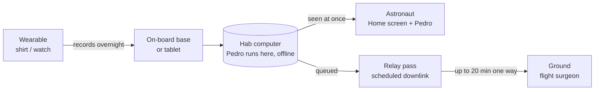

**In our prototype.** No device is connected. `web/src/lib/console/wearable.ts` generates one reading per person per sol:

- **Repeatable:** the same person and sol always give the same value.
- **Personal:** each person has their own baseline.
- **Tied to their day:** short sleep and a heavy workload raise heart rate and breathing and lower HRV.
- **Two scripted stories for the demo:**
  - Kenji Sato's HRV falls under sustained workload.
  - Daniela Reyes shows an early-infection pattern: skin temperature, heart rate and breathing climb from Sol 140.

To connect a real device, replace `vitals()` with readings from the hab gateway. Everything downstream stays the same.

### How a status is decided (code, not AI)

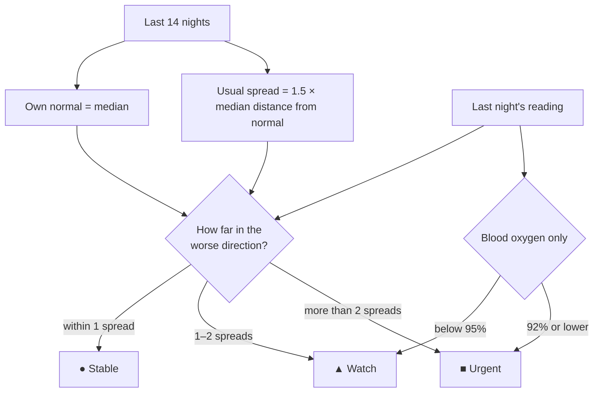

- People are **never compared with each other**, only with themselves.
- Every status has a shape and a word as well as a colour (● Stable, ▲ Watch, ■ Urgent), so nobody depends on colour alone.

---

## 3. 3D body map

### Why we need it

1. **The challenge asks for it almost word for word.** "The software could display a human figure where each part of the body is clickable and displays information about its function and health status."
2. **No sensor measures pain or a rash.** The person has to tell us, and a tap on the body is faster and more precise than typing "my left shoulder, the back part".
3. **Exercise is mandatory in space, and it hurts sometimes.** NASA says crews exercise "to counteract losses in bone density, muscle strength, and heart and blood vessel performance" ([NASA HRP Risks](https://www.nasa.gov/hrp/risks/)). A pain that keeps coming back in the same place is the signal, and the map shows repeats.
4. **The flight surgeon can see exactly where.** Earth gets the place, the rating and the note, not "some pain".

### How it works

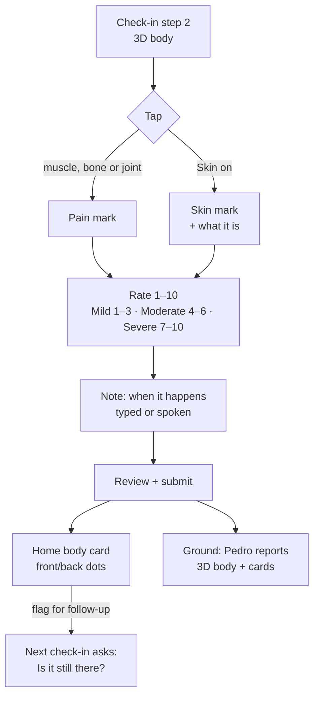

- **Anatomy from Japan:** BodyParts3D 4.0 by the Database Center for Life Science (DBCLS), Japan, CC BY 4.0 ([source](https://dbarchive.biosciencedbc.jp/en/bodyparts3d/download.html)), shown in the open-source Somakine viewer (MIT). The app uses English labels only and serves the 3D files itself, with no outside connection. Muscles, bones and joints, real jaw and neck muscles, and approximate face muscles.
- **Skin layer:** 24 areas per side (forehead to foot). Types: rash, bite or sting, cut or scrape, bruise, burn, itch, dry or cracked, blister, swelling.
- **Required before moving on:** a 1–10 rating and a note on when it happens. Skin marks also need their type.
- **Voice:** hold the mic and describe it. The words become the note, "out of ten" sets the rating, and words like "rash" set the type.
- **History:** parts marked on earlier sols glow, so repeats are visible.
- **The body map doesn't diagnose.** It records where and how much. Pedro and the Ground screens say so.

---

## 4. Ground console (flight surgeon on Earth)

Ground is the second role in the app. The sidebar has **Dashboard**, **Escalations** and **Pedro reports**. Everything is a delayed view: the top bar shows the last downlink, the light time and the next pass.

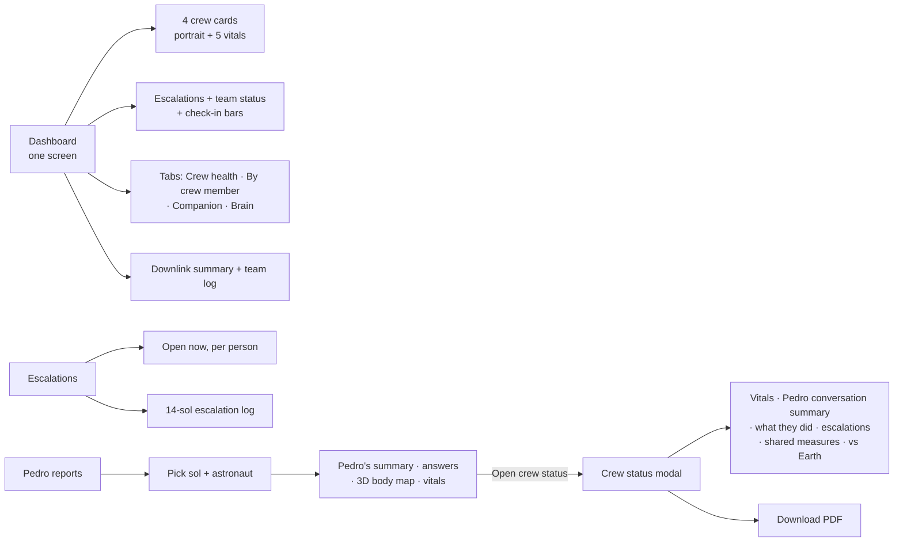

| Screen | What the flight surgeon learns |
|---|---|
| **Dashboard** | Who is off their normal right now: vitals on every card, open escalations, team areas (sleep, mood, workload, teamwork), check-in adherence, team log |
| **Escalations** | Act statuses, urgent vitals and Pedro emergency notices, by name, plus a 14-sol log |
| **Pedro reports** | Each astronaut's check-in for a chosen sol. Pedro's summary is written by code from the numbers, so it can't invent anything. Shows answers against their normal, and the body map with pins and notes |
| **Crew status** | One person in depth, including the comparison with healthy-adult ranges on Earth and a printable PDF report |

### What reaches Earth, and what never does

| Reaches Ground, by name | Never leaves the hab |
|---|---|
| Measures the person chooses to share, with values | Journals |
| Any measure at Act, without values if not shared | The astronaut's own words to Pedro |
| Wearable vitals | |
| Body map marks: place, rating, type, note | |
| Pedro conversation summary: counts, what was logged, Pedro's replies | |
| That an emergency notice was given (not what was said) | |

### Astronaut vs a typical adult on Earth

The crew status page compares the person with a healthy-adult range on Earth, but **only where a source gives one**:

| Measure | Range | Source |
|---|---|---|
| Resting pulse | 60–100 bpm | MedlinePlus |
| Breathing | 12–18 /min | MedlinePlus |
| Blood oxygen | 95–100% | MedlinePlus |
| Sleep | 7 h or more (adults 18–60) | CDC |

HRV, skin temperature, reaction time, mood, workload and teamwork have no single healthy number. They are compared only with the person's own normal, and the screen says so. Every row is labelled "reference only, not a diagnosis".

---

## 5. Pedro's brain: what we added

Pedro answers only from files in `brain/`. We added 7 files, each citing its source, and 22 test questions.

| File | Pedro can now answer | Source |
|---|---|---|
| `measures/resting-heart-rate.md` | What is normal, what to do on Watch or Urgent | MedlinePlus, NASA HRP, CSA |
| `measures/heart-rate-variability.md` | Why HRV is only compared with yourself | Cleveland Clinic |
| `measures/blood-oxygen.md` | Normal range, when to call the medical officer | MedlinePlus, CSA |
| `measures/skin-temperature.md` | Why skin temperature isn't a fever reading | CSA, MedlinePlus |
| `measures/breathing-rate.md` | Normal range, what to do | MedlinePlus, CSA |
| `procedures/body-map.md` | How to mark pain or a rash, when to report it | App design, NASA HRP |
| `reference/mission/what-reaches-earth.md` | How data gets to Earth, the delay, who sees what | CSA, NASA HRP, app design |

- **Safety rules unchanged:** no diagnosis, no medicine advice, the crew medical officer for anything urgent, and the red-flag check runs before the model.
- **Review status:** all 7 files are marked `authorised_by: Pending clinical review`. No clinician has reviewed them.

---

## 6. Workflows, step by step

### 6.1 An astronaut's day with Pedro

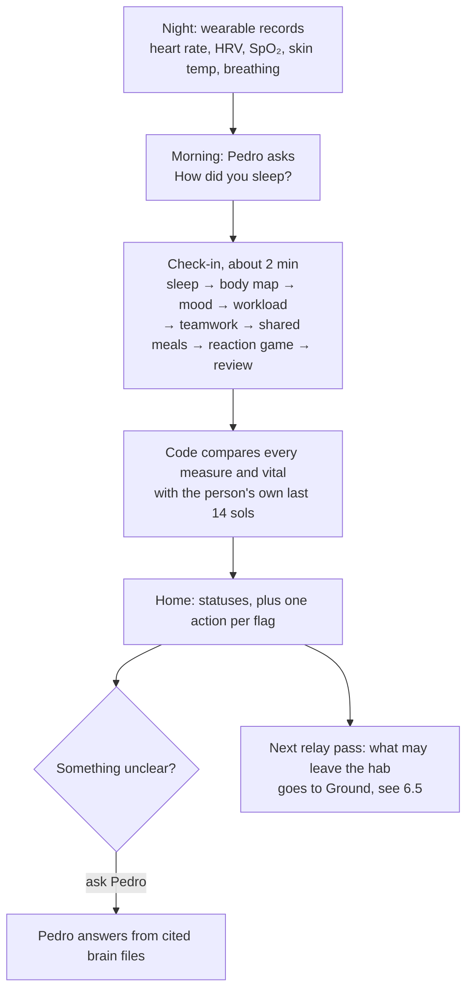

### 6.2 How Pedro answers a question

Two safety layers run side by side. The keyword check is instant and works with the AI switched off. The AI safety label reads what the message means, such as "there's a heavy squeezing feeling in the middle of my chest", which no phrase list would catch. **The model can only add a flag, never clear one.** If it fails or times out, the keywords decide alone.

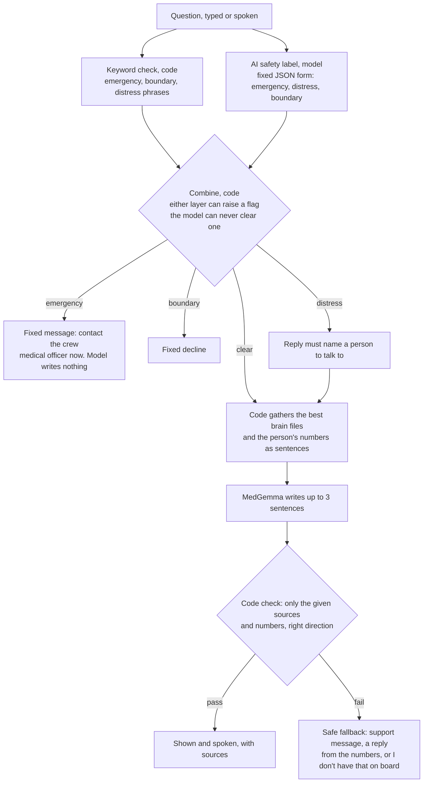

### 6.3 From one bad day to Ground

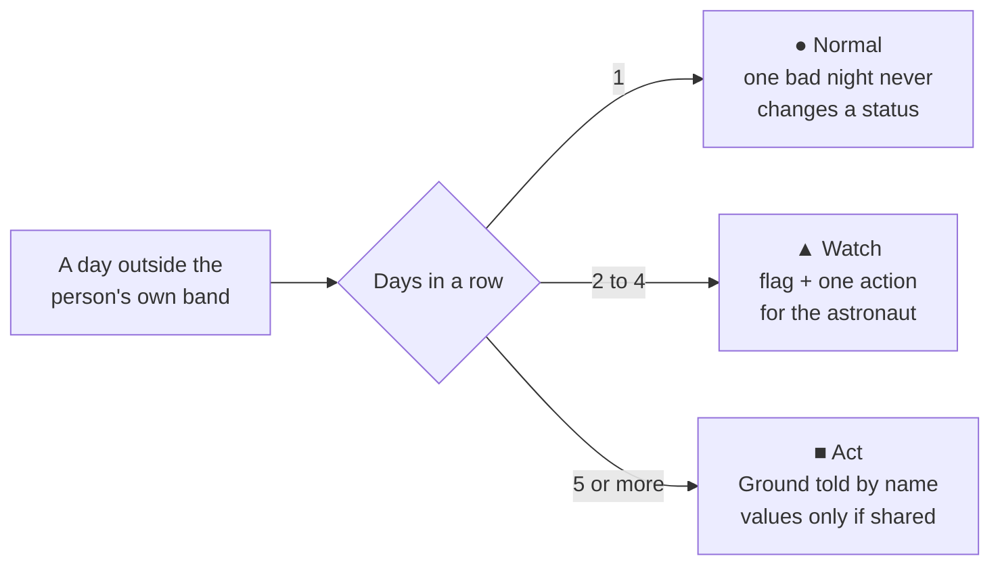

### 6.4 Emergency notice

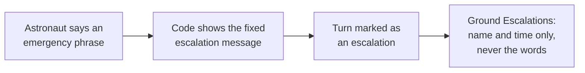

### 6.5 What can leave the hab

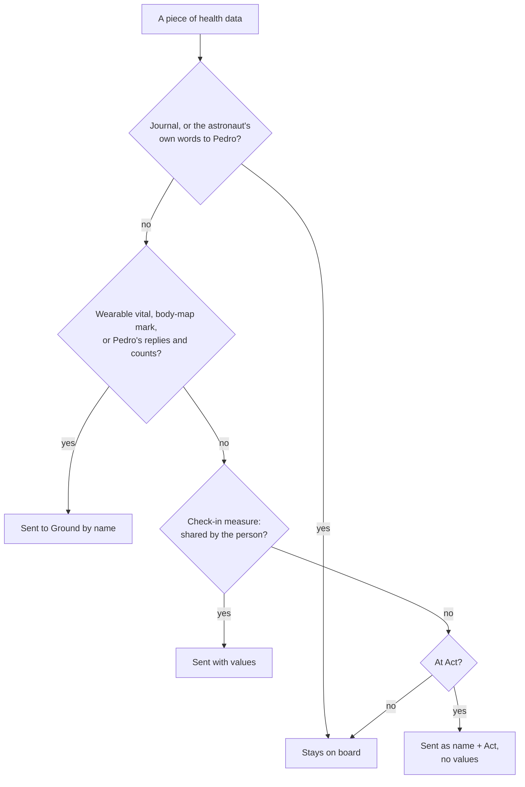

### 6.6 How a Pedro report and its PDF are made

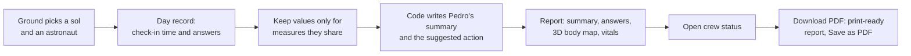

### 6.7 How Pedro's knowledge is updated

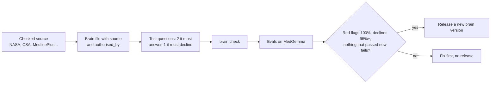

## 7. NASA studies this work follows

Each page below was opened and checked. Each line gives a short quote and what it backs in Pedro.

| NASA page | What it says | What it backs in Pedro |
|---|---|---|
| [ARCHeR](https://www.nasa.gov/reference/archer/) | "measure astronauts' well-being, activity, sleep patterns, and interactions during the Artemis campaign"; "using actigraphy and behavioral performance surveys" | Daily check-in plus wearable: the same mix of surveys and worn sensors |
| [Artemis II Standard Measures](https://www.nasa.gov/reference/artemis-ii-standard-measures/) | data "gathered before, during, and after a mission" on "nutritional status, cardiovascular health, and immunological function" | Tracking the same people over time against their own normal |
| [Immune Biomarkers](https://www.nasa.gov/reference/immune-biomarkers/) | how "stress hormones, viruses, and cells may be affected by flight conditions" | Watching skin temperature, heart rate and breathing for an early illness pattern |
| [Tempus Pro](https://www.nasa.gov/reference/tempus-pro/) | "collecting and integrating vital health data"; "communication delays will become more significant" | Vitals on one screen, and a Ground view built for delay |
| [Hazard: Isolation and Confinement](https://www.nasa.gov/hrp/hazard-isolation-and-confinement/) | "Sleep loss, circadian desynchronization, and work overload compound this issue"; experts are "developing methods for monitoring behavioral health" | The core measures: sleep, sleep timing, workload, mood, teamwork |
| [Hazard: Distance from Earth](https://www.nasa.gov/hrp/hazard-distance-from-earth/) | "a communication delay of up to 20 minutes one way" | On-board first, offline AI, Ground as a delayed view |
| [Hazard: Gravity Fields](https://www.nasa.gov/hrp/hazard-gravity-fields/) | weightlessness "can lead to dizziness, bone and muscle loss"; bones "lose on average 1% to 1.5% of mineral density per month" | Body map for exercise pain that keeps coming back |
| [Risks of Human Spaceflight](https://www.nasa.gov/hrp/risks/) | "Weightlessness alters blood circulation and how the heart and blood vessels function" | Resting heart rate and HRV |
| [Hazard: Space Radiation](https://www.nasa.gov/hrp/hazard-space-radiation/) | "Space radiation is invisible to the human eye" | **Not covered yet.** Radiation dose is our biggest gap (see the CSA radiation article) |
| [The Human Body in Space](https://www.nasa.gov/humans-in-space/the-human-body-in-space/) | crews "must be able to solve problems and identify solutions as a team without help from NASA's mission control" | The whole design: the crew catches it on board |

## 8. Honest limits

- **Vitals are simulated.** No device is connected.
- **Pedro can explain a vital but can't see yours yet.** The chat isn't sent the vitals numbers. Wiring that in is the next code task.
- **Ground runs in the same browser as the crew screens.** There is no real downlink. The delay, passes and "delayed view" are modelled.
- **Real body-map pins** reach Ground only from check-ins submitted on that device. Other crew show simulated pins, labelled as such.
- **HRV from a wrist device is imprecise.** The Cleveland Clinic page says wrist trackers "usually aren't sensitive enough to detect HRV accurately", so we only flag runs of nights against the person's own normal.

## 9. Sources

- NASA HRP, [5 Hazards](https://www.nasa.gov/hrp/hazards/), [Risks](https://www.nasa.gov/hrp/risks/), [Distance from Earth](https://www.nasa.gov/hrp/hazard-distance-from-earth/)
- CSA, [Bio-Monitor](https://www.asc-csa.gc.ca/eng/sciences/bio-monitor.asp)
- MedlinePlus, [Vital signs](https://medlineplus.gov/ency/article/002341.htm), [Pulse oximetry](https://medlineplus.gov/lab-tests/pulse-oximetry/)
- CDC, [About sleep](https://www.cdc.gov/sleep/about/index.html)
- DBCLS (Japan), [BodyParts3D](https://dbarchive.biosciencedbc.jp/en/bodyparts3d/download.html), CC BY 4.0
- Cleveland Clinic, [Heart rate variability](https://my.clevelandclinic.org/health/symptoms/21773-heart-rate-variability-hrv)

## 10. What we cut, and why

Each of these was in the app or a draft. We couldn't find a source that says it, so it's gone.

| Cut | Why |
|---|---|
| "Fit adults often have a resting rate of 40–60" | The source page was unreachable |
| HRV "20–100 ms" healthy range | The only cited range is for a 24-hour clinical recording, not a watch reading |
| Skin temperature "32–35 °C" and "rises before a fever" | No source found |
| Reaction time "200–300 ms" Earth range | No source found. We keep the 355 ms PVT-B limit, cited in the submission |
| Breathing "12–20" | The source says 12–18 |
| Sleep "7–9 h" | The CDC says "7 or more" for adults 18–60 |
| CO₂ "makes you breathe faster and causes headaches" | NASA's hazard pages don't say this |
| Low back pain from spine lengthening | NASA's spine article doesn't say this |
| Mars delay "3 to 22 min" | NASA says "up to 20 minutes one way". The model is now capped at 20 |
| Muscle, joint and skin first-aid brain files | The first-aid thresholds were unsourced. The body-map file covers how to report instead |

---

# Part B: How every feature works (full reference)

Exact rules, taken from the code. Use this to answer "how does it work?" questions.

## 11. The simulated mission

| Item | Value |
|---|---|
| Mission / site | Meridian-2, Hab-1, 180 sols. "Today" is Sol 142, 14:26 LMST (Mars local time) |
| Crew | Adaeze Okafor (Commander, CDR) · Mattias Lindqvist (Flight engineer, FE) · Kenji Sato (Mission specialist, geology, MS-1) · Daniela Reyes (Mission specialist, life support, MS-2) |
| Data | Made by code from a seed: the same sol always gives the same values. No real crew data |
| Calibration | Average sleep 6.09 h a night, from NASA-funded Barger et al. 2014 ([PubMed](https://pubmed.ncbi.nlm.nih.gov/25127232/)). Day-to-day movement is our own assumption, listed in `docs/tech-spec/eval-design.md` |
| Hab schedule | First duty 08:30, lights dim 22:30 |
| Relay passes (Ground) | 06:30, 12:30, 18:30 and 23:30 LMST. One-way light time modelled at 3 to 20 min |
| Demo stories | Lindqvist: workload at Act. Reyes: engagement at Act and an early-infection vitals pattern. Sato: HRV falling, reaction time slowing |
| Roles ("View as") | Astronaut or Ground |
| Mission timeline | The strip on the far left. Drag it to any past sol and every screen recomputes as of that sol |

## 12. The daily check-in, step by step

| Step | What is asked | What is stored |
|---|---|---|
| 1. Sleep | When did you fall asleep and wake up? | Hours slept, and the sleep midpoint (body-clock drift) |
| 2. Body | 3D body map (section 3) or "No pain today" | Each mark: part, 1–10 rating, note, skin type |
| 3. Mood | 1 to 5 | Rating |
| 4. Workload | 1 to 5 | Rating |
| 5. Teamwork | 1 to 5 | Rating |
| 6. Shared meals | Did you eat with the crew? | Yes/no |
| 7. Reaction game (optional) | 10 rounds: wait for green, press Space (or tap). Pressing too soon restarts that round | Median time, and the count of slow presses over 355 ms (the PVT-B lapse limit, Basner et al. 2011) |
| 8. Review | Today against your normal | Submitted and saved on this device |

- **Voice:** any answer can be spoken. The local model turns speech into fields, which the person checks before saving.
- **Timing:** the check-in stays open until 23:00. Skipping is allowed, but missed check-ins count towards Engagement.

## 13. The seven measures

| Code | Measure | How we get it | Worse direction | Smallest band |
|---|---|---|---|---|
| SL-03 | Sleep duration | Worked out from the sleep times | Lower | 24 min |
| SL-07 | Sleep timing | Midpoint between falling asleep and waking | Either way | 25 min |
| PF-01 | Reaction time | Median of the 10 game rounds | Slower | 15 ms |
| MD-02 | Mood | Self-rating 1–5 | Lower | 0.75 |
| WL-02 | Workload & stress | Self-rating 1–5 | Higher | 0.75 |
| TM-04 | Teamwork | Self-rating 1–5, plus shared meals | Lower | 0.75 |
| EN-01 | Engagement | **Measured, never asked:** words said to Pedro each sol, and check-ins missed in the last 7 days | Lower | 60 words |

## 14. The maths behind every status

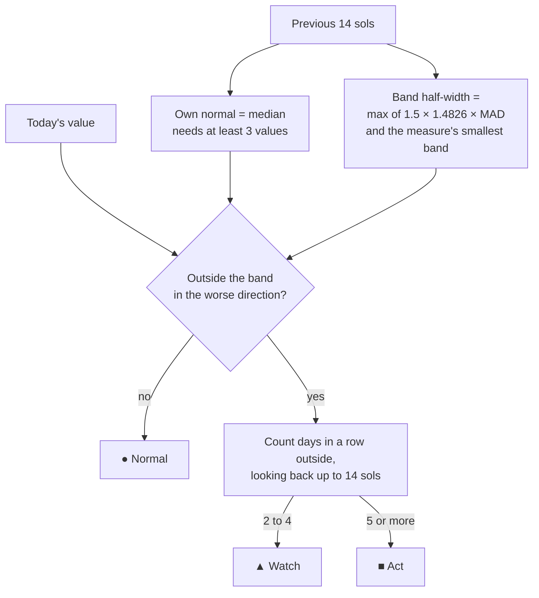

- **MAD** is the median absolute deviation, a robust measure of someone's usual spread. 1.4826 scales it to match a standard deviation. The smallest band stops a very steady person from being flagged for a tiny change.
- **Engagement has an extra rule:** 2 missed check-ins in 7 days means Watch, 3 or more means Act.
- **Fewer than 3 values:** "no baseline yet". Nothing is flagged until there's enough data.
- **Vitals use a nightly version of the same idea** (section 2): one to two spreads means Watch, more than two means Urgent, plus fixed floors for blood oxygen.

## 15. Home screen (astronaut)

- **Measure cards:** status, today's value, the change from normal and a small chart. Click a card for full stats, including the normal band over time. Drag a card to reorder.
- **Flags:** "what changed" plus one action, for example "Sleep midpoint shifted 51 min later over 3 nights" → "Start wind-down at 23:30 tonight".
- **Tone setting:** Gentle ("worth an earlier wind-down") or Direct ("Start wind-down earlier tonight").
- **Wearable strip:** the five vitals, with how long until Earth sees them.
- **Body card:** front and back pictures with a dot per mark. Details opens the marks, where any can be flagged for follow-up.
- **Alerts and Mission log:** side panels that open beside the page.

## 16. Pedro, the companion

- **Runs on the laptop:** MedGemma 4B (Google, open weights) through Ollama, with no internet needed. An optional Claude API comparison mode is off by default.
- **Knowledge:** 29 active files in `brain/` (reference, procedures, measures), each with a source and who approved it.
- **Pipeline:** see 6.2. Keyword checks and an AI safety label run side by side. The model can add a safety flag but never clear one. Code makes every safety decision and handles every number.
- **Voice:** speech in and out through the browser. Every spoken line also appears as text.
- **Tested by 93 questions:** 41 answerable, 19 boundary, 11 conversation, 10 decline, 5 red-flag, 3 support.

## 17. Settings and sharing (astronaut)

| Setting | Options | Effect |
|---|---|---|
| Tone | Gentle / Direct | How flags and suggestions are worded |
| Voice | On / Off | Pedro speaks aloud. Text is always shown |
| Sharing | Private / Share aggregates, plus a toggle per measure | Which measures reach the crew view (as aggregates) and Ground (with values) |

## 18. Crew view (inside the hab)

- **Aggregates only:** no names and no individual values.
- **A measure appears only when at least 2 crew share it.**
- **Team status per area:** Normal when all sharing crew are inside their own normal. Watch when one or more are outside it. Act when anyone sharing has been outside it for 5+ days in a row.
- **Also shown:** tiles for check-ins, shared meals, engagement and open flags, anonymous support prompts, and a team log of the last 3 sols.

## 19. Ground console details

- **Delayed view:** last downlink, one-way light time and next pass at the top of every Ground page.
- **Escalations:** Act statuses (any measure, shared or not) and Pedro emergency notices from the last 14 sols, by name. The Escalations page also lists urgent vitals.
- **Draft downlink summary:** the AI writes a short read of crew-level numbers only, and any number it invents is caught and replaced.
- **Companion activity:** counts from Pedro's local turn log, such as questions asked and answered, "not on board" replies and escalations. Never the questions themselves.
- **Brain on board:** the brain version on the hab and the latest eval runs, which Earth checks before sending a new knowledge package.

## 20. How we test it

The details are in the submission ("Does it work").

| Test | What it checks | Result |
|---|---|---|
| Detection | Simulated crew, 90 days, a healthy twin for every declining person | Pedro's rule caught 98% of hidden declines, with too many false alarms (88% of healthy twins flagged) |
| Emergency | Red-flag phrases | All 5 listed phrases escalated. On sealed real-world wording, only 4 of 32. The phrase list is too narrow |
| Answers | 93 questions on MedGemma 4B | See the latest report in `brain/evals/results/` |

## Links (full URLs)

Every link in this document, printed in full so it still works on paper.

- NASA: <https://www.nasa.gov/humans-in-space/the-human-body-in-space/>
- NASA: <https://www.nasa.gov/hrp/hazard-isolation-and-confinement/>
- NASA: <https://www.nasa.gov/hrp/risks/>
- NASA: <https://www.nasa.gov/hrp/hazard-gravity-fields/>
- NASA: <https://www.nasa.gov/hrp/hazard-distance-from-earth/>
- NASA: <https://www.nasa.gov/reference/tempus-pro/>
- MedlinePlus: <https://medlineplus.gov/ency/article/002341.htm>
- Cleveland Clinic: <https://my.clevelandclinic.org/health/symptoms/21773-heart-rate-variability-hrv>
- MedlinePlus: <https://medlineplus.gov/lab-tests/pulse-oximetry/>
- CSA Bio-Monitor: <https://www.asc-csa.gc.ca/eng/sciences/bio-monitor.asp>
- source: <https://dbarchive.biosciencedbc.jp/en/bodyparts3d/download.html>
- ARCHeR: <https://www.nasa.gov/reference/archer/>
- Artemis II Standard Measures: <https://www.nasa.gov/reference/artemis-ii-standard-measures/>
- Immune Biomarkers: <https://www.nasa.gov/reference/immune-biomarkers/>
- Hazard: Space Radiation: <https://www.nasa.gov/hrp/hazard-space-radiation/>
- 5 Hazards: <https://www.nasa.gov/hrp/hazards/>
- About sleep: <https://www.cdc.gov/sleep/about/index.html>
- PubMed: <https://pubmed.ncbi.nlm.nih.gov/25127232/>
