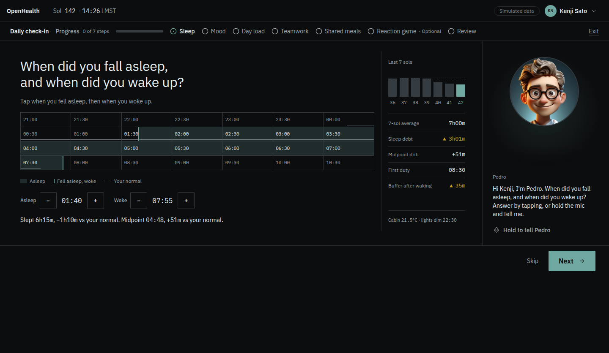
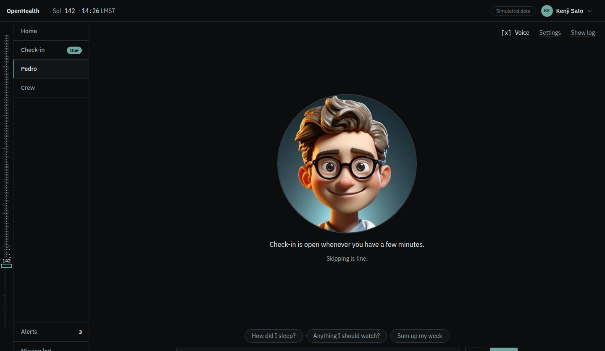

# OpenHealth: Space Apps 2026 submission text

**How to use this file.** Each part below matches one field on the team's Project page (profile icon → My Team → Project → Edit). Copy the text under each `FIELD` heading into that field. Do not paste the `FIELD` headings themselves or this note.

**Before you click "Submit for Judging", fix every `[TODO]`:**

- [ ] Add the **demo link** (a video of 30 seconds or less, or at most 7 slides), shared publicly with no login.
- [ ] Add the **team name and members** in FIELD 4.
- [ ] Each teammate adds any SI tools they used that aren't listed yet in FIELD 5.
- [ ] Confirm where Pedro's portrait (`web/public/companion/base.png`) came from. If an SI tool made it, it needs a **visible watermark** under the rules (see FIELD 5).
- [ ] The images below use GitHub links, so they only work once `docs/product/submission/` is pushed to `main`. Otherwise, upload the PNGs from this folder straight onto the Project page (JPG/PNG up to 10 MB).
- [ ] Open every link in a private browser window.
- [ ] Tick both boxes (Terms and Conditions, Confirm All Work is Original), then click **Submit for Judging**. You can resubmit until Sun 15 Nov, 11:59 p.m. local time.

---

## FIELD 1: Project Name

OpenHealth

---

## FIELD 2: High-Level Project Summary

OpenHealth is a health companion for astronauts on long missions. It runs on one laptop, with no internet and no link to Earth. Every day the crew member does a two-minute check-in by tapping or talking: when they slept, mood, workload, teamwork, shared meals, and an optional reaction-time tap game. OpenHealth compares each answer with **that person's own normal**, not with anyone else's. Each measure gets a plain label: **Normal**, **Watch** or **Act**. Every flag comes with one thing to do about it today.

A small SI model running on the laptop, named "Pedro", explains the numbers in plain words and answers questions. It only uses a folder of sourced, human-readable files, and it says "I don't have that on board" rather than guess. The maths, the safety checks and the emergency messages are ordinary code, so the companion keeps working with the model switched off.

Why it matters: NASA's Human Research Program lists isolation and confinement as one of the five hazards of spaceflight. The early signs (sleeping later, slower reactions, pulling away from the crew) are exactly the changes a person is least likely to notice or report in themselves. On a Mars mission, help from Earth can be up to 20 minutes away each way, so the crew has to spot these changes on board.

---

## FIELD 3: Link to Project Demo

`[TODO: public link to the 30-second video or the slide deck of 7 slides or fewer]`

---

## FIELD 4: Link to Final Project

https://github.com/egoistlabs/openhealth

---

## FIELD 5: Detailed Project Description

### Team

`[TODO: team name]`, `[TODO: member names]`. Challenge: **Create Health Monitoring Software for Astronauts on Space Missions**.

### What it does

OpenHealth has four screens.

**1. Daily check-in.** About two minutes, in seven steps. You can tap or hold the mic and speak.

- **Sleep:** when you fell asleep and when you woke up. The app works out hours slept and the middle of your sleep, which shows whether your body clock is drifting.
- **Mood, workload, teamwork:** a rating from 1 to 5 each.
- **Shared meals:** did you eat with the crew today?
- **Reaction game (optional):** a short tap test modelled on the PVT-B test that astronauts already use on the ISS. A tap slower than 355 ms counts as a slow response.
- **Engagement:** counted, not asked. It is how much you talk to the companion, and a missed check-in is counted too.
- **Review:** see what you entered before saving it.

**2. Home: "me against my own normal".** Your normal for each measure is the middle value of your previous 14 days, and the band around it is how much you usually vary.

- Outside the band for 2 or more days → **Watch**.
- Outside it for 5 or more days → **Act**.
- One bad night never changes a status.

Each status has a text label as well as a colour, so it still reads without colour. Every flag says what changed in plain words ("Sleep midpoint shifted 51 min later over 3 nights") and gives one suggested action ("Start wind-down at 23:30 tonight"). This view is **private**: nothing leaves it unless you choose to share.

**3. Pedro, the companion.** Ask "How did I sleep?", "Anything I should watch?" or "Why is my reaction time flagged?" by typing or by voice. Pedro answers in at most three sentences, says it out loud, and shows the sources it used: where each one came from, its date, and who approved it.

**4. Crew view.** Crew-level numbers only: no names and no individual values. A measure appears only when at least 2 crew members share it. It shows whether the team as a whole is drifting (for example "1 of 3 sharing crew outside their normal" on teamwork), together with support prompts and a team log.

### How it works

**Design rule: code does the maths, the model only talks.** A small model can get numbers wrong or make things up, so it never computes a status, never decides whether something is an emergency, and never sees a raw number it could misread. Code turns each number into a finished sentence first, and the model can only rephrase sentences it was given.

When you ask Pedro a question, six steps run in order:

1. **Red-flag check (code).** Your words are compared with a fixed list of emergency phrases (chest pain, trouble breathing, thoughts of self-harm and others). On a match, you get a fixed message telling you to contact the crew medical officer now. The model is never called.
2. **Gather (code).** Code finds the 3 best-matching files in the knowledge folder (the "brain") and, if you asked about yourself, your numbers already written as sentences.
3. **Enough to answer? (code).** If nothing matches, the reply is "I don't have that on board." The model is never called.
4. **Write (model).** The model reads only what step 2 gathered, then replies in a fixed format: the sources it used, then the answer.
5. **Check (code).** The reply is rejected if it cites a source it wasn't given, contains a number that appears in no source, or describes a change backwards (e.g. "faster" for a slower reaction time). Repeated or overly long answers are trimmed.
6. **Show and speak.** Only the checked answer is shown and read aloud, together with its sources.

**The brain is a folder of plain files, not model training.** It follows the Interpretable Context Methodology (ICM, [arXiv 2603.16021](https://arxiv.org/abs/2603.16021)): what the companion knows lives in short Markdown files (sleep, isolation, teamwork, workload, reaction time and so on), each tagged with its source and who approved it. A flight surgeon could read and edit it without retraining anything, and a new file only goes in after the tests pass. The brain is versioned (currently v2.0.0) with a fingerprint per file, so every test result names the exact content it was run against.

**Fully offline by default.** The model is MedGemma 4B, Google's medical-tuned open model (4 billion parameters, 3.3 GB). It runs locally through Ollama on a MacBook with 16 GB of memory. A setting (`LOCAL_LLM=false`) can switch to the Anthropic Claude API for comparison. Off by default, this mode sends the question and the selected files to Anthropic, and the README says so.

### How we tested it (and where it still falls short)

Each check below runs from the repo with one command and gives real output. We report failures as they are. **All crew data is simulated. No clinician has reviewed the content or the tests.**

**Detection test: does it catch a decline the person doesn't notice?** This runs with no model. It simulates 500 healthy crew members and 200 crew members per type of decline over 90 days (sleep debt, going quiet, crew friction, body-clock drift). Sleep figures are calibrated to published NASA-funded studies (Barger et al. 2014: 6.09 h a night on ISS missions).

- In the scenario where the person **notices none of their own decline**, asking alone caught **2%**, and OpenHealth's rule flagged **98%** within 21 days.
- **Weakness:** the rule also flags healthy people too often. That's 6.8 false "Watch" flags per person in 90 days against our target of 1, and 88% of healthy twins get flagged in the same window. So the rule is very sensitive, but its false-alarm rate still needs tuning. We report this instead of hiding it.

**Emergency test: does it escalate real emergencies said in a person's own words?**

- Listed phrases: 5 of 5 escalated.
- Unseen, real-world wording (a sealed set we never read while editing the list): only **4 of 32**, against a target of 90%. The keyword list is too narrow, and widening it is our top open task.
- Safety floor that holds: in **0 of 59** missed emergencies did the person get a reply that names no one to contact.

**Answer test (with the model).** We ran 30 answerable questions, 11 it should decline and 5 red flags on MedGemma 4B on brain v1. Results: answerable 27/30, declined correctly 11/11, red flags 5/5. Caveat: we wrote the questions ourselves, and we found the model sometimes copies a worked example from its instructions. We now count that copying as a failure.

### Benefits

- Catches slow changes **before** the person reports them, with no wearable and no consumables: just a laptop.
- Private by design. Personal data stays on the laptop, and the crew view is crew-level numbers only.
- Explainable. Every flag says what changed, and every answer shows its sources.
- Still works with the model off. Statuses, flags and emergency messages are code.

### What we hope to achieve

A tool a crew could actually trust on a long mission: one that notices what people don't say, explains it in plain words, and points to one useful action. Next steps: tune the alert rule to about one false alarm a month, widen the emergency list until the sealed set passes, swap browser speech for fully on-device speech (Kokoro for the voice, a local speech-to-text model), and have a flight surgeon review the brain.

### Tools, languages, hardware and software

| What | Used for |
| --- | --- |
| TypeScript, React 19, Next.js 16 | The app and its server routes |
| Tailwind CSS 4, Radix UI, lucide-react | Styling and UI parts |
| Three.js | Pedro's animated avatar and lip-sync |
| Vercel AI SDK (`ai`, `@ai-sdk/openai`, `@ai-sdk/anthropic`) | Streaming the model's reply |
| Zod | Checking every message between browser and server |
| Ollama + MedGemma 4B (Q4_K_M) | The on-laptop model (default) |
| Anthropic Claude API | Optional comparison mode, off by default |
| Web Speech API (browser) | Voice input and spoken replies in this prototype. Note: in Chrome, speech-to-text can use the browser maker's online service, so it is not yet fully offline |
| Node.js scripts | Test suites, mission simulator, brain version and check tools |
| Hardware | One laptop: MacBook M4, 16 GB (demo machine). No sensors |

---

## FIELD 6: Use of Super Intelligence (SI)

Yes. We used SI tools in two different ways, and we keep them apart below: **(A) SI inside the product** and **(B) SI tools that helped us build it.**

### A. SI inside the product

| Part | SI used | What it does, and its limits |
| --- | --- | --- |
| Pedro's answers | **MedGemma 4B** (Google, open weights), run locally with **Ollama** | Rephrases sourced material into plain answers. It does **not** compute statuses, decide emergencies or invent numbers: code does all of that and checks every answer (see the six steps above). |
| Optional comparison mode | **Anthropic Claude** through the API (`LOCAL_LLM=false`) | Same pipeline and same checks. Off by default. Sends data off the laptop, which the README states. |
| Voice | Browser **speech recognition and speech synthesis** (Web Speech API) | Turns speech into text and reads the checked answer aloud. Pedro's voice is computer-generated, and the app labels Pedro as an SI companion. |
| Check-in by voice | Same local model (stage `01-checkin-parse`) | Turns a spoken answer such as "slept around 1:40, up at 8" into fields. You review the result before it is saved. |

How SI output is marked inside the product:

- Every answer shows the source files it came from.
- The brain files record their source and who approved them.
- Every test report records which model and which brain version produced it.
- Every turn is written to a local log, so any answer can be traced.

### B. SI tools used to build the project

| Tool | What we used it for | What people did |
| --- | --- | --- |
| **Claude Code** (Anthropic; Claude Fable 5.2 and Claude Opus 5.5 models) | Finding and summarising published research and NASA pages; drafting the docs (tech spec, eval design, user stories); writing and editing parts of the code and the test scripts; drafting the brain's knowledge files from cited sources; drafting this submission text; turning our real test output into the terminal screenshots shown here | The team chose the challenge, the hazard (isolation and confinement), the seven measures and the scope in our own brainstorming document. Team members reviewed, edited and tested what was generated and decided what went in. |
| `[TODO: each teammate adds their tools, e.g. other coding assistants or chatbots]` | | |

Labels on SI-generated content (as the rules require):

- **Code and data:** commits made with Claude Code carry a `Co-Authored-By: Claude` line in the git history (Claude Fable 5.2 and Claude Opus 5.5). `[TODO: teammates whose commits used SI but carry no such line, say which parts here]` Knowledge files in `brain/` carry `source` and `authorised_by` fields. All crew data is simulated by our own code (`web/src/lib/sim/mission.ts`, `npm run sim:mission`) and labelled "Simulated data" on every screen.
- **Images:** the four app screenshots are real captures of the running app. The two terminal images show real, unedited command output, rendered as an image with an SI tool. `[TODO: if Pedro's portrait was made with an SI image tool, name the tool here and add a visible "SI-generated" watermark to web/public/companion/base.png]`
- **Audio:** Pedro's spoken voice is computer-generated text-to-speech.
- No SI-generated content uses NASA logos or branding.

---

## FIELD 7: NASA Data

We used NASA's Human Research Program (HRP) resources from the challenge page to pick what to measure and to write the companion's knowledge files:

- **[The 5 Hazards of Human Spaceflight](https://www.nasa.gov/hrp/hazards/)** (HRP). We chose one hazard, **isolation and confinement**, and built every measure around it. Thirteen knowledge files in `brain/reference/` cite it as their source.
- **[NASA Human Research Roadmap: Risks](https://humanresearchroadmap.nasa.gov/risks/)**, specifically the *Risk of Adverse Cognitive or Behavioral Conditions and Psychiatric Disorders*, used for the behavioural-health files.
- **[How does spaceflight affect astronauts? (NASA, "The Human Body in Space")](https://www.nasa.gov/humans-in-space/the-human-body-in-space/)**, which describes the ISS's short vigilance self-test for fatigue and the crew-journal research on isolation. These shaped our reaction game and our engagement measure.
- **[HRP Evidence Report: Behavioral Medicine (BMed)](https://humanresearchroadmap.nasa.gov/Evidence/reports/BMed.pdf)**, background on sleep, circadian rhythm and behavioural health on missions.

NASA-funded studies used to calibrate the simulated crew data and the reaction test:

- Barger et al., *Lancet Neurology* 2014 ([PubMed 25127232](https://pubmed.ncbi.nlm.nih.gov/25127232/)): ISS and Shuttle crews slept 6.09 h a night in flight, and 5.86 h in the 11 days before launch.
- Flynn-Evans et al., *npj Microgravity* 2016 ([PubMed 28725719](https://pubmed.ncbi.nlm.nih.gov/28725719/)): 19% of in-flight sleep periods were out of step with the body clock.
- Basner et al., *Acta Astronautica* 2011 ([PubMed 22025811](https://pubmed.ncbi.nlm.nih.gov/22025811/)): the 3-minute PVT-B reaction test used on the ISS, with the 355 ms slow-response limit our game uses.

**Being honest about data:** we searched NASA's open data repositories (including OSDR) for per-day crew data on these seven measures and found none that is openly downloadable. The ISS Reaction Self-Test data is available on request only. So our crew data is **simulated**, calibrated to the published figures above, and labelled "Simulated data" everywhere in the app.

---

## FIELD 8: Space Agency Partner Data and Other References

**Space agency resources from the challenge page (background reading):** Canadian Space Agency, *Why Do We Conduct Science Experiments in Space?* and *Monitoring Radiation for Astronaut Health*.

**Research and methods**

- Van Clief and McDermott, *Interpretable Context Methodology* (2026), [arXiv 2603.16021](https://arxiv.org/abs/2603.16021), and its [reference repository](https://github.com/RinDig/Interpretable-Context-Methodology): the layout of the companion's "brain" folder.
- Van Dongen et al., *Sleep* 2003 ([PubMed 12683469](https://pubmed.ncbi.nlm.nih.gov/12683469/)): sleep debt that people do not feel. Six hours a night for 14 days impaired performance as much as up to 2 nights without sleep.
- Emergency warning signs used to write and test the red-flag list: [NHLBI heart attack symptoms](https://www.nhlbi.nih.gov/health/heart-attack/symptoms), [NINDS stroke](https://www.ninds.nih.gov/health-information/disorders/stroke), [NIMH warning signs of suicide](https://www.nimh.nih.gov/health/publications/warning-signs-of-suicide).

**Models and runtimes**

- [MedGemma 4B](https://ollama.com/library/medgemma:4b) (Google, open weights, Health AI Developer Foundations terms)
- [Ollama](https://ollama.com)
- Anthropic Claude API (optional mode)

**Open-source software:** Next.js, React, TypeScript, Tailwind CSS, Radix UI, lucide-react, Three.js, Vercel AI SDK, Zod, Node.js. All are used under their open-source licences, which are listed in `web/package.json`.

**Images:** all screenshots are of our own app and our own test output. `[TODO: source and licence of Pedro's portrait, web/public/companion/base.png]`

No copyrighted material is used without permission. OpenHealth is a prototype, **not a medical device**, and its content has not been reviewed by a clinician.
