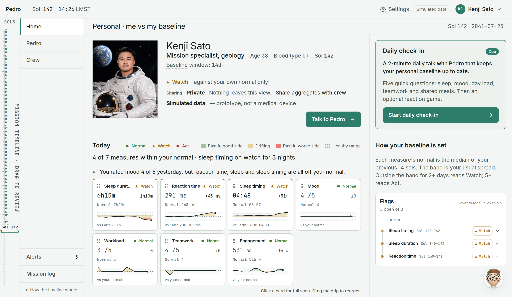
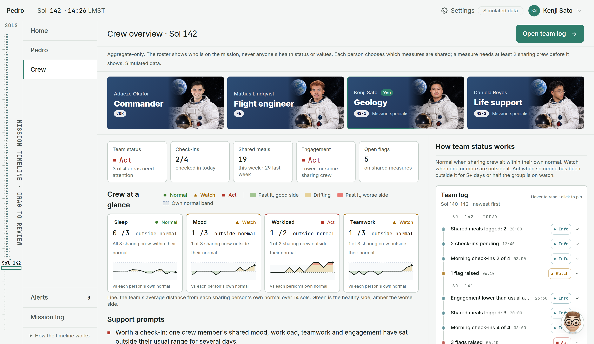
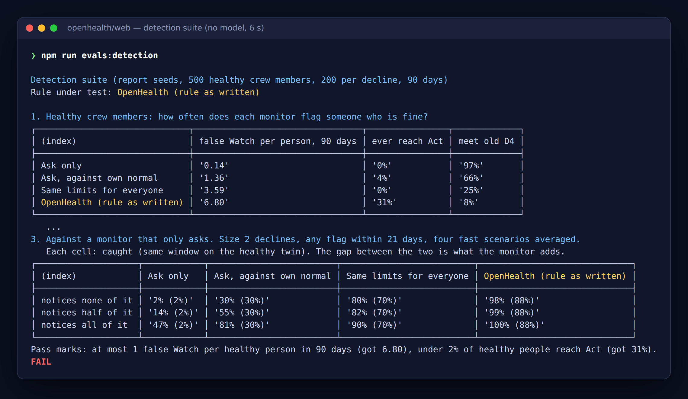
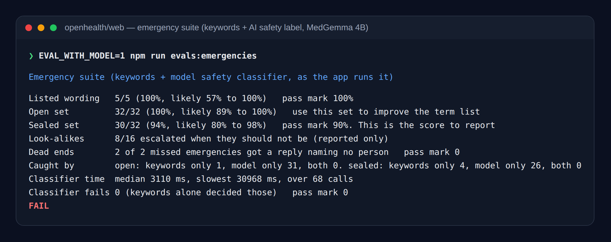

# Pedro: Space Apps 2026 submission text

**How to use this file.** Each part below matches one field on the team's Project page (profile icon → My Team → Project → Edit). Copy the text under each `FIELD` heading into that field. Do not paste the `FIELD` headings themselves or this note.

**Before you click "Submit for Judging", fix every `[TODO]`:**

- [ ] Add the **demo link** (a video of 30 seconds or less, or at most 7 slides), shared publicly with no login.
- [ ] Each teammate adds any SI tools they used that aren't listed yet in FIELD 6, and says which of their commits used SI without a `Co-Authored-By` line.
- [ ] Confirm where Pedro's portrait (`web/public/companion/base.png`) came from. If an SI tool made it, it needs a **visible watermark** under the rules (see FIELD 6), and its source and licence go in FIELD 8.
- [ ] The images below use GitHub links, so they only work once `docs/product/submission/` is pushed to `main`. Otherwise, upload the PNGs from this folder straight onto the Project page (JPG/PNG up to 10 MB).
- [ ] Retake the four app screenshots: the current ones still show the old OpenHealth name.
- [ ] Decide how the summary reports the 98%: the detection test scores the design-spec version of the flag rule, not the app's own code (see FIELD 5, "Does it work"). Either point the test at the app's rule and rerun it, or reword the summary.
- [ ] Open every link in a private browser window.
- [ ] Tick both boxes (Terms and Conditions, Confirm All Work is Original), then click **Submit for Judging**. You can resubmit until Sun 15 Nov, 11:59 p.m. local time.

---

## FIELD 1: Project Name

Pedro

---

## FIELD 2: High-Level Project Summary

*This field is plain text only: it shows as one paragraph with no formatting or links. Paste the paragraph below exactly as it is. The sources are in FIELD 5 and FIELD 7.*

I'm Pedro, an AI companion with medical knowledge. I live on the ship's laptop, because there's no internet on the way to Mars. NASA's research finds that the more cut off people are, the more likely they are to develop behavioral, cognitive or psychiatric problems. Those problems start small: astronauts sleep worse, react slower and stop talking to each other, and they're usually the last to notice. The small signs matter. Six hours of sleep a night for two weeks can hurt performance as badly as going up to two nights without sleep, and people in that state don't feel it. Astronauts in orbit average about six hours. Earth can't watch over them: a message takes up to 20 minutes each way. So every day, each astronaut does a two-minute check-in with me covering exactly those early signs: sleep, mood, teamwork and a quick reaction game like the one NASA uses on the space station to spot fatigue. I compare their answers with their own normal. When something drifts, like sleep shifting 51 minutes later over three nights, I tell them what changed in plain words and suggest one thing to do. I answer only from a built-in library of NASA research, I show my sources, and when I don't know, I say so. In our team's simulation, just asking crew how they felt caught 2% of the declines they hadn't noticed in themselves. I caught 98%, though I still raise too many false alarms, which the team is fixing next.

---

## FIELD 3: Link to Project Demo

`[TODO: public link to the 30-second video or the slide deck of 7 slides or fewer]`

---

## FIELD 4: Link to Final Project

https://github.com/egoistlabs/openhealth

---

## FIELD 5: Detailed Project Description

### The problem: isolation wears crews down in ways they can't see, and Earth is too far away to see it for them

**Isolation is one of NASA's five hazards of human spaceflight** ([NASA HRP](https://www.nasa.gov/hrp/hazards/)). NASA's research finds that "the more restricted the space, and the less contact with people outside the environment, the more likely humans are to develop behavioral or cognitive conditions or psychiatric disorders" ([NASA](https://www.nasa.gov/humans-in-space/the-human-body-in-space/)).

**Those problems start with small signs, and each one matters:**

- **Sleep.** Crews in orbit slept 6.09 hours a night on average ([Barger et al. 2014](https://pubmed.ncbi.nlm.nih.gov/25127232/)), and 19% of in-flight sleep periods were out of step with the body clock ([Flynn-Evans et al. 2016](https://pubmed.ncbi.nlm.nih.gov/28725719/)). Six hours a night for 14 days hurts performance as badly as up to two nights without sleep, and people in that state don't feel it ([Van Dongen et al. 2003](https://pubmed.ncbi.nlm.nih.gov/12683469/)).
- **Reaction time.** Slower reactions are a measurable sign of fatigue, which is why astronauts on the ISS take a 3-minute reaction test ([Basner et al. 2011](https://pubmed.ncbi.nlm.nih.gov/22025811/)).
- **Mood, workload and teamwork.** These are the day-to-day face of NASA's *Risk of Adverse Cognitive or Behavioral Conditions and Psychiatric Disorders* ([NASA Human Research Roadmap](https://humanresearchroadmap.nasa.gov/risks/)). A small crew shares one space for months, so one person's slide reaches the whole team.
- **Going quiet.** Withdrawing from the crew is part of the same decline. NASA's crew-journal research on isolation shaped how we measure it ([NASA](https://www.nasa.gov/humans-in-space/the-human-body-in-space/)).

**The person living it is the worst-placed to report it.** The National Academies describe institutional pressure on astronauts to under-report symptoms ([*Safe Passage*, 2001](https://nap.nationalacademies.org/read/10218/chapter/8)), and sleep debt hides itself.

**Nobody else on board or on Earth can catch it in time:**

- **Earth** is up to 20 minutes away each way by message on a Mars mission.
- **The crew medical officer** is a crewmate with about 40 hours of medical training ([npj Microgravity 2023](https://pmc.ncbi.nlm.nih.gov/articles/PMC10284846/)).
- **Cloud AI** needs an internet connection the ship doesn't have.
- **Wearables** can track sleep but can't measure mood or teamwork.
- **Asking people how they feel** misses exactly what they don't notice.

### Pedro catches the decline astronauts miss in themselves, with one laptop and no internet

Pedro is an AI companion with medical knowledge, built for crews too far from Earth for anyone there to keep watch.

- **It catches what people don't report.** In our simulation, just asking crew how they felt caught 2% of the declines they hadn't noticed in themselves. Pedro's flag rule caught 98%.
- **Nothing extra to fly.** No wearable, no sensors and no consumables: one laptop, offline by default.
- **It doesn't guess.** Code does the maths and the safety checks and checks every reply. The AI model only writes the words.
- **It keeps working if the AI fails.** Statuses, flags and emergency messages are all code, so they still work with the model switched off.
- **We know where it falls short.** It raises too many false alarms, and its emergency phrase list is too narrow. Both are measured below, and both are our next steps.

### What it does: a two-minute daily check-in, compared with your own normal

**1. Daily check-in.** About two minutes, by tap or by voice.

- **Sleep:** when you fell asleep and woke up. Pedro works out hours slept and the middle of your sleep, which shows whether your body clock is drifting.
- **Mood, workload, teamwork:** a rating from 1 to 5 each.
- **Shared meals:** whether you ate with the crew today.
- **Reaction game (optional):** a short tap test modelled on the PVT-B test astronauts use on the ISS. A tap slower than 355 ms counts as slow.
- **Review:** a look at your answers before you save them.

Pedro also counts how much you talk to it and any missed check-ins.

**2. Home: you against your own normal.** Your normal for each measure is the middle value of your previous 14 days, and the band around it is how much you usually vary.

- 2 or more days outside your band → **Watch**. 5 or more → **Act**. One bad night never changes a status.
- Every status has a text label as well as a colour.
- Every flag says what changed and gives one action, for example "Sleep midpoint shifted 51 min later over 3 nights" → "Start wind-down at 23:30 tonight".
- Nothing on this screen leaves it unless you choose to share.

**3. Talk to Pedro.** Type or speak. Ask "How did I sleep?" or "Why is my reaction time flagged?" and Pedro answers out loud, showing each source with where it came from, its date and who approved it. You can also just talk: Pedro listens and offers small reflection or connection ideas, but states no fact that a source doesn't back.

**4. Crew view.** Crew-level numbers only, with no names or individual values, and a measure appears only when at least 2 crew members share it. It shows whether the team is drifting (for example "1 of 3 sharing crew outside their normal" on teamwork), with support prompts and a team log.

### How it works: code does the maths and safety checks, the AI model only writes the words

1. **Red-flag check (code).** Emergency phrases such as chest pain, trouble breathing or thoughts of self-harm get a fixed message: contact the crew medical officer now. The model is never called.
2. **Boundary check (code).** Requests to role-play, override the rules or reveal a crewmate's answers get a fixed decline. The model is never called.
3. **Distress check (code).** Signs of serious distress don't stop the reply, but the reply must then name a person to talk to.
4. **Gather (code).** Pedro picks the best-matching entries from its knowledge library and, if you asked about yourself, your numbers already written out as sentences. The model never sees a raw number.
5. **Write (model).** The model chooses its sources and replies. Code cuts it off if a sentence repeats or the reply runs past three sentences.
6. **Check (code).** An answer may cite only the sources it was given and use only numbers from them, and must describe each change in the right direction. Casual conversation may contain no numbers, diagnoses or medicines. If a reply fails, code replaces it with a support message, a reply written from your numbers, or "I don't have that on board."
7. **Show and speak.** Only the checked reply reaches you, with its sources.

**The knowledge library is plain files, not model training.** Each entry is a short file on a topic such as sleep, isolation, teamwork, workload or reaction time, tagged with its source and who approved it. The layout follows the Interpretable Context Methodology ([arXiv 2603.16021](https://arxiv.org/abs/2603.16021)). A new entry goes in only after the tests pass, and every test result records the exact library version it ran against.

**Offline by default.** MedGemma 4B, Google's open medical AI model (3.3 GB), runs on the laptop. A comparison mode that uses the Anthropic Claude API is off by default, and when switched on it sends the question and the chosen sources to Anthropic. One gap remains: voice input in Chrome can use the browser maker's online speech service, so typing is the fully offline way to use Pedro today.

### Does it work: in simulation, 98% of hidden declines caught, with too many false alarms

All crew data is simulated and labelled "Simulated data" on every screen. No clinician has reviewed the content or the tests. Each test runs from the public repo with one command.

**Detection test.** 500 healthy simulated crew members and 200 per type of decline (sleep debt, going quiet, crew friction, body-clock drift), over 90 days, with sleep calibrated to NASA-funded studies (Barger et al. 2014: 6.09 h a night on ISS missions). Two features keep the test honest:

- **A healthy twin for every declining crew member**: the same person on the same days with nothing wrong, so every false alarm counts against us.
- **An awareness dial**: the person notices none, half or all of their own decline, and their mood rating drops by that much. Without it, "asking misses it" would be true by design.

Four ways to watch a crew, on medium declines the person doesn't notice at all. Each shows the declines flagged within 21 days, then the healthy twins flagged anyway:

- **Just ask how they feel:** 2% caught, 2% of twins flagged.
- **Ask, and compare with their own normal:** 30% caught, 30% of twins flagged.
- **Same fixed limits for everyone:** 80% caught, 70% of twins flagged.
- **Pedro's flag rule:** 98% caught, 88% of twins flagged.

- **Asking only works when people notice.** It catches 2% of declines when the person notices nothing, 14% when they notice half, and 47% when they notice all of it.
- **Measuring finds what asking misses.** Sleep times, reaction time and engagement keep moving while the person says they're fine.
- **The rule raises too many false alarms.** It flags 88% of healthy twins: 6.8 false Watch flags per healthy person in 90 days, against our pass mark of 1. A stricter setting cuts that to 2.2 and still catches 77% of declines within 21 days.
- **The test scores the flag rule from our design spec.** The app's rule differs (Watch after 2 days outside the band), and the test doesn't run the app's own code yet.

**Emergency test.** All 5 listed phrases were escalated. On a sealed set of real-world wording we never read while writing the list, only 4 of 32 were escalated, against a pass mark of 90%, because the phrase list is too narrow. In all 59 missed emergencies, the reply still named someone to contact.

**Answer test.** With MedGemma 4B, Pedro answered 25 of 30 answerable questions correctly, declined all 11 it should decline and escalated all 5 red flags. We wrote the questions ourselves, and we count it as a failure when the model copies an example from its instructions.

### Impact: a crew that can look after itself far from Earth

NASA is building toward medical care for Moon and Mars crews that doesn't depend on Earth ([Wilderness Environ Med 2025](https://pubmed.ncbi.nlm.nih.gov/39865932/)). Pedro covers one part of that care: the slow slide in sleep, mood and teamwork that the person living it doesn't see.

Next steps:

1. Widen the emergency phrase list until the sealed set passes.
2. Tune the flag rule to about one false alarm a month, and test the app's own code.
3. Replace browser speech with on-device speech.
4. Have a flight surgeon review the knowledge library.

### What's creative, and the factors behind each choice

Each risk we weighed led to one design choice. The sections above describe how each works.

- **Astronauts miss and under-report their own decline.** Pedro measures rather than only asks, against each person's own normal, since one astronaut's normal can be another's warning sign.
- **Going quiet is part of the decline.** Pedro counts engagement instead of asking about it.
- **Earth is too far away, and there is no internet.** Everything runs on the laptop.
- **A small AI model can get numbers wrong, make things up, or play along with "pretend to be my doctor".** Code does the maths and the safety checks and checks every reply. The model only writes the words.
- **An emergency can't wait for a model.** The red-flag check runs first, in code.
- **In a crew of a few people, any number points to someone.** The crew view shows only crew-level numbers.
- **Too many alerts get ignored.** One bad night never changes a status, and false alarms have a pass mark.
- **A tired crew member won't read a wall of text.** Replies are short and read aloud.
- **Medical content has to be checkable.** The knowledge library is plain, sourced files that a flight surgeon could edit without retraining anything.
- **No open NASA dataset has per-day crew data for these measures.** The crew is simulated and calibrated to published studies (see Field 7).

### Tools, languages, hardware and software

- **TypeScript, React 19, Next.js 16:** the app and its server.
- **Tailwind CSS 4, Radix UI, lucide-react:** styling and interface parts.
- **Three.js:** Pedro's animated avatar and lip-sync.
- **Vercel AI SDK:** streaming the model's reply.
- **Zod:** checking every message between browser and server.
- **Ollama + MedGemma 4B:** the on-laptop AI model.
- **Anthropic Claude API:** optional comparison mode, off by default.
- **Web Speech API:** voice input and spoken replies.
- **Node.js:** test suites and the crew simulator.
- **Mermaid:** the flow diagram above.
- **Hardware:** one laptop, a MacBook M4 with 16 GB. No sensors.

---

## FIELD 6: Use of Super Intelligence (SI)

Yes. We used SI tools in two different ways, and we keep them apart below: **(A) SI inside the product** and **(B) SI tools that helped us build it.**

### A. SI inside the product

- **Pedro's replies: MedGemma 4B** (Google, open weights), run locally with **Ollama**. It writes replies from sourced material. It does **not** compute statuses, decide emergencies or invent numbers: code does all of that and checks every reply (see the seven steps in Field 5).
- **Optional comparison mode: Anthropic Claude** through the API (`LOCAL_LLM=false`). Same pipeline and same checks. Off by default. Sends data off the laptop, which the README states.
- **Voice:** browser **speech recognition and speech synthesis** (Web Speech API). Turns speech into text and reads the checked reply aloud. Pedro's voice is computer-generated, and the app labels Pedro as an SI companion.
- **Check-in by voice:** the same local model (stage `01-checkin-parse`). Turns a spoken answer such as "slept around 1:40, up at 8" into fields. You review the result before it is saved.

How SI output is marked inside the product:

- Every answer shows the source files it came from.
- The brain files record their source and who approved them.
- Every test report records which model and which brain version produced it.
- Every turn is written to a local log, so any answer can be traced.

### B. SI tools used to build the project

**Claude Code** (Anthropic; Claude Fable 5.2 and Claude Opus 5.5 models)

- **What we used it for:** finding and summarising published research and NASA pages; drafting the docs (tech spec, eval design, user stories); writing and editing parts of the code and the test scripts; drafting the brain's knowledge files from cited sources; drafting this submission text; turning our real test output into the terminal screenshots shown here; drawing the flow diagram in Field 5.
- **What people did:** the team chose the challenge, the hazards (isolation and confinement, distance from Earth), the seven measures and the scope in our own brainstorming document. Team members reviewed, edited and tested what was generated and decided what went in.

`[TODO: each teammate adds their tools, e.g. other coding assistants or chatbots, with what they used them for]`

Labels on SI-generated content (as the rules require):

- **Code and data:** commits made with Claude Code carry a `Co-Authored-By: Claude` line in the git history (Claude Fable 5.2 and Claude Opus 5.5). `[TODO: teammates whose commits used SI but carry no such line, say which parts here]` Knowledge files in `brain/` carry `source` and `authorised_by` fields. All crew data is simulated by our own code (`web/src/lib/sim/mission.ts`, `npm run sim:mission`) and labelled "Simulated data" on every screen.
- **Images:** the four app screenshots are real captures of the running app. The two terminal images show real, unedited command output, rendered as an image with an SI tool. The flow diagram in Field 5 was drawn with an SI tool from Pedro's code, and the image itself says so. `[TODO: if Pedro's portrait was made with an SI image tool, name the tool here and add a visible "SI-generated" watermark to web/public/companion/base.png]`
- **Audio:** Pedro's spoken voice is computer-generated text-to-speech.
- No SI-generated content uses NASA logos or branding.

---

## FIELD 7: NASA Data

We used NASA's Human Research Program (HRP) resources from the challenge page to pick what to measure and to write Pedro's knowledge files:

- **[The 5 Hazards of Human Spaceflight](https://www.nasa.gov/hrp/hazards/)** (HRP). We chose two hazards that hit together: **isolation and confinement**, which causes the decline we measure, and **distance from Earth**, which is why the crew has to catch it on board, offline. Ten of the twelve knowledge files in `brain/reference/` cite it as their source.
- **[NASA Human Research Roadmap: Risks](https://humanresearchroadmap.nasa.gov/risks/)**, specifically the *Risk of Adverse Cognitive or Behavioral Conditions and Psychiatric Disorders*, used for the behavioural-health files.
- **[How does spaceflight affect astronauts? (NASA, "The Human Body in Space")](https://www.nasa.gov/humans-in-space/the-human-body-in-space/)**, which describes the ISS's short vigilance self-test for fatigue and the crew-journal research on isolation. These shaped our reaction game and our engagement measure. It is also the source for the message delay in our summary: on Mars there is "a communication delay of up to 20 minutes one-way".
- **[HRP Evidence Report: Behavioral Medicine (BMed)](https://humanresearchroadmap.nasa.gov/Evidence/reports/BMed.pdf)**, background on sleep, circadian rhythm and behavioural health on missions.

NASA-funded studies used to calibrate the simulated crew data and the reaction test:

- Barger et al., *Lancet Neurology* 2014 ([PubMed 25127232](https://pubmed.ncbi.nlm.nih.gov/25127232/)): ISS and Shuttle crews slept 6.09 h a night in flight, and 5.86 h in the 11 days before launch.
- Flynn-Evans et al., *npj Microgravity* 2016 ([PubMed 28725719](https://pubmed.ncbi.nlm.nih.gov/28725719/)): 19% of in-flight sleep periods were out of step with the body clock.
- Basner et al., *Acta Astronautica* 2011 ([PubMed 22025811](https://pubmed.ncbi.nlm.nih.gov/22025811/)): the 3-minute PVT-B reaction test used on the ISS, with the 355 ms slow-response limit our game uses.

**Being honest about data:** we searched NASA's open data repositories (including OSDR) for per-day crew data on these seven measures and found none that is openly downloadable. The ISS Reaction Self-Test data is available on request only. So our crew data is **simulated**, calibrated to the published figures above, and labelled "Simulated data" everywhere in the app.

---

## FIELD 8: Space Agency Partner Data and Other References

**Space agency resources from the challenge page (background reading):** Canadian Space Agency, *Why Do We Conduct Science Experiments in Space?* and *Monitoring Radiation for Astronaut Health*.

**Research and methods**

- Van Clief and McDermott, *Interpretable Context Methodology* (2026), [arXiv 2603.16021](https://arxiv.org/abs/2603.16021), and its [reference repository](https://github.com/RinDig/Interpretable-Context-Methodology): the layout of Pedro's "brain" folder.
- Van Dongen et al., *Sleep* 2003 ([PubMed 12683469](https://pubmed.ncbi.nlm.nih.gov/12683469/)): sleep debt that people do not feel. Six hours a night for 14 days impaired performance as much as up to 2 nights without sleep.
- National Academies, *Safe Passage: Astronaut Care for Exploration Missions* (2001), [ch. 8](https://nap.nationalacademies.org/read/10218/chapter/8), "Institutional Pressure to Underreport Clinical Signs, Symptoms, and Medical Data": astronauts' reluctance to report.
- *Development of Progressively Earth-Independent Medical Operations to Enable NASA Exploration Missions*, Wilderness Environ Med 2025 ([PubMed 39865932](https://pubmed.ncbi.nlm.nih.gov/39865932/)): NASA's Exploration Medical Capability work on care for Moon and Mars crews that doesn't depend on Earth.
- *The value of a spaceflight clinical decision support system*, npj Microgravity 2023 ([PMC10284846](https://pmc.ncbi.nlm.nih.gov/articles/PMC10284846/)): a crew medical officer with no doctor on board has about 40 hours of medical training.
- Emergency warning signs used to write and test the red-flag list: [NHLBI heart attack symptoms](https://www.nhlbi.nih.gov/health/heart-attack/symptoms), [NINDS stroke](https://www.ninds.nih.gov/health-information/disorders/stroke), [NIMH warning signs of suicide](https://www.nimh.nih.gov/health/publications/warning-signs-of-suicide).

**Models and runtimes**

- [MedGemma 4B](https://ollama.com/library/medgemma:4b) (Google, open weights, Health AI Developer Foundations terms)
- [Ollama](https://ollama.com)
- Anthropic Claude API (optional mode)

**Open-source software:** Next.js, React, TypeScript, Tailwind CSS, Radix UI, lucide-react, Three.js, Vercel AI SDK, Zod, Node.js. All are used under their open-source licences, which are listed in `web/package.json`.

**Images:** all screenshots are of our own app and our own test output. `[TODO: source and licence of Pedro's portrait, web/public/companion/base.png]`

No copyrighted material is used without permission. Pedro is a prototype, **not a medical device**, and its content has not been reviewed by a clinician.
